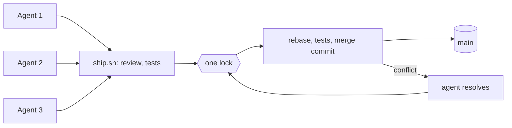

# polyship

**Run many coding agents on one repository. Their branches land one at a time, tested.**

Each agent works in its own git worktree. When it finishes a task, it commits and runs `scripts/ship.sh`. The
script reviews the branch, runs your tests, and merges it into `main` under one lock for the whole repository.
If two agents touched the same lines, an agent resolves the conflict and the branch goes back to the queue.

- **Parallel sessions**: Claude Code, Codex or any other agent, each in its own worktree.
- **One merge at a time**: rebase, test again, merge commit. `main` never gets a tree that was not tested.
- **Any stack**: you give the install and test commands. polyship is a few bash scripts on top of
  [Worktrunk](https://worktrunk.dev).


## How many agents, and how safe

polyship was measured before release. The data and the method are in [measurements/REPORT.md](measurements/REPORT.md).

- **20 Claude Code sessions** worked at once on tasks that touch the same files. 20 of 20 landed. Every commit
  on `main` passed the tests.
- **3,000 simulated sessions** (300 runs of 10), with random conflicts, flaky tests and `kill -9` at random
  moments. No lost work, no untested commit on `main`, no stuck queue.
- **300 kills** at a random moment of `ship.sh`, followed by the recovery that its messages ask for. 0 lost, 0 stuck.
- Each failure found on the way has its own replay test (195 checks). They run on every change.
- Codex was measured once: 4 of 10 sessions landed. The other 6 did not finish (most ended their turn while
  `ship.sh` still ran), and none of them broke `main`. The agent instructions below now tell agents to wait for the exit code.

How many sessions you can run depends on how long your tests take. Merges go one at a time, so with a suite of
`T` seconds, at most `3600 / T` branches land per hour.

| Test suite | Sessions at once (tasks of ~30 min) | Wait for the lock (p95) |
|---|---|---|
| 15 s | 30 | under 15 s |
| 3 min | 3 to 4 | under 5 min |

In practice you hit another limit first: the attention you need to follow several agents. That limit was
4 to 5 sessions in our own logs.

What the queue cannot catch: two agents writing the same helper twice, or one task quietly changing another
task's behavior while the tests stay green. The review step and your tests are where these get caught.

## Install

In your repository, on macOS or Linux:

```bash
curl -fsSL https://raw.githubusercontent.com/ivklgn/polyship/main/install.sh | sh
```

It copies `ship.sh`, `merge.sh` and `lib.sh` into `scripts/`. You commit them, so every session, sandbox
and cloud runner uses the same scripts. Run the command again to update.

You also need bash, perl, git 2.40+ and Worktrunk 0.80+:

```bash
brew install worktrunk && wt config shell install
```

**Or let your agent do it.** Tell it:

```text
Install polyship into this repository: follow https://github.com/ivklgn/polyship/blob/main/INSTALL.md
```

It finds your install and test commands, sets everything up, ships a test branch to check the setup, and
reports back.

## Try it

Tell polyship how to prepare and test your project in `.config/wt.toml`, and commit it:

```toml
[post-start]   # optional: prepare a new worktree
deps = "npm ci"

[pre-merge]    # the gate: runs on the rebased branch, under the lock
test = "npm test"
```

```bash
wt config approvals add --yes   # once per repository, so agents are never stopped by a prompt
```

Then, in a worktree with a committed task:

```bash
scripts/ship.sh
```

Exit code 0 means the branch is on `main`. To see three sessions land without any agent, run
[example/demo.sh](example/README.md).

If your worktrees start from `origin/main` (Claude Code and Codex worktrees usually do), set
`MERGE_PUSH=origin`. Then each merge is pushed under the lock, and the next session starts from up-to-date code.

## Tell your agents

Add this to `CLAUDE.md` or `AGENTS.md`:

```markdown
## Shipping

- A task ends with `scripts/ship.sh`. Commit first. Exit code 0 means the branch is on the target.
- `ship.sh` runs for minutes (review, tests, the queue). Run it in the foreground and wait for its exit code;
  do not end your turn while it runs, and do not report the task shipped without exit code 0.
- Write the intent of the task into the commit message, not only what changed.
- If a conflict is between two incompatible product behaviors, do not choose. Leave the rebase open
  and ask the owner, with both options (`ship.sh` exits with 3).
- Exit code 5 means lost commits: run the `git reset --hard` command from the message. If the tree has
  uncommitted changes, `git stash -u` first and `git stash pop` after: the reset deletes them.
```

The intent has to be in the commit messages because an agent that later resolves a conflict sees only the
commits, not your chat.

## How it works



1. An agent reviews the branch and fixes what it finds (`SHIP_REVIEW=0` turns this off).
2. The tests run, outside the lock.
3. `merge.sh` takes the lock, rebases onto `main`, runs the `pre-merge` tests again and merges with a merge
   commit. Every first-parent commit of `main` is a tested tree.
4. On a conflict, an agent resolves it and the branch goes back to the queue.

## Contributing and license

See [CONTRIBUTING.md](CONTRIBUTING.md). polyship is released under the [MIT License](LICENSE).

## Quick reference

`ship.sh`: review, tests, merge, conflict rounds. `merge.sh [wt merge flags]`: only the locked merge.

| Exit | `ship.sh` | `merge.sh` |
|---|---|---|
| 0 | The branch is on the target. | Same. |
| 1 | The tests failed, or there is no progress. | `MERGE_PREPARE` failed, a fresh git lock file is in the way, or (`MERGE_PUSH`) the fetch or the push failed; the target is back where it was. |
| 2 | Not ready: on the target, a detached HEAD, uncommitted changes, an open rebase, or `merge.sh` refused (below). | Run by `ship.sh`'s agent, no target branch, or (`MERGE_PUSH`) a local commit on the target that the remote lacks. |
| 3 | The owner must choose between two product behaviors. The rebase stays open. | |
| 4 | The target, a remote or `.git/hooks` changed while the agent ran, other than by another session's `merge.sh`. Run again. | |
| 5 | The branch is on the target, but its commits are not. Run the `git reset --hard <tip>` from the message (`git stash -u` first if the tree has changes). | Same. |
| other | | The code from `wt merge`. |

| Variable | Default | Meaning |
|---|---|---|
| `MERGE_TARGET` | `wt config state default-branch` | The branch every session merges into. |
| `MERGE_PUSH` | none | A remote: take its target under the lock before each merge, push each merge, land only what it took. |
| `MERGE_PREPARE` | none | `sh -c` command under the lock before the merge, for worktrees that skipped `post-start`. |
| `MERGE_STALE_INDEX_LOCK` | `60` | Seconds after which a git lock file counts as left by a killed command. |
| `SHIP_TEST` | `wt hook pre-merge --yes` | The tests before the queue. |
| `SHIP_AGENT` | `claude`, else `codex` | The agent for the review and conflicts. |
| `SHIP_REVIEW` | `1` | `0` skips the review. |
| `SHIP_REVIEW_HOW` | `for correctness, the task in the commit messages, tests` | How the agent reviews; name your own review skill or checklist here. |
| `SHIP_ROUNDS` | `10` | Merge rounds per `ship.sh` run. |
| `SHIP_AGENT_RUN` | set by `ship.sh` | Marks `ship.sh`'s agent runs; `merge.sh` refuses to run under it. |

[ship.sh spec](.archcore/architecture/ship-sh.spec.md) ·
[merge.sh spec](.archcore/architecture/merge-sh.spec.md) ·
[Known limits](.archcore/architecture/known-limits.doc.md) ·
[Measurements](measurements/REPORT.md)
